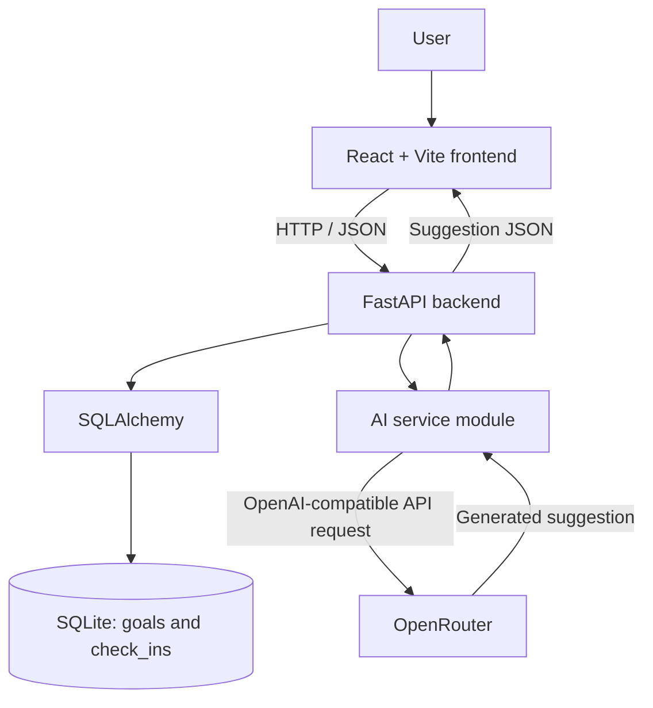

# ReStart — Architecture

## 1. Overview

ReStart is a local web prototype with a React/Vite frontend, FastAPI backend, SQLite persistence through SQLAlchemy, and an external LLM request through OpenRouter.

## 2. Main components

### Frontend

The React application provides the user interface for:
- Creating habit goals.
- Recording check-in status, notes and barriers.
- Displaying goals and check-in history.
- Requesting and displaying a suggestion after a missed check-in.

The suggestion is held in frontend state. It is not written to the SQLite database.

### Backend

`main.py` defines FastAPI routes, request schemas, CORS configuration, database access and the suggestion endpoint.

`models.py` defines SQLAlchemy models.

`database.py` configures the SQLite engine, session factory and database dependency. It also contains the startup helper that adds the `barrier` column to an older `check_ins` table if needed.

`ai_service.py` loads environment variables and uses the OpenAI Python client with the configured OpenRouter-compatible endpoint.

### Persistence

SQLite stores:
- Goals.
- Check-in records, including status, note and barrier.

It does not currently store AI-generated suggestions or date/time metadata for check-ins.

## 3. Missed-check-in request flow

1. The user submits a missed check-in from the frontend.
2. The frontend sends a `POST /check-ins` request.
3. FastAPI validates the request with Pydantic.
4. The backend checks that the referenced goal exists.
5. SQLAlchemy saves the check-in in SQLite.
6. The backend returns the saved check-in identifier.
7. The frontend requests `GET /check-ins/{check_in_id}/suggestion`.
8. The backend confirms that the check-in exists, is marked missed, and has an associated goal.
9. The AI service sends relevant goal/check-in context to the configured external model.
10. The backend returns the generated suggestion in the API response.
11. The frontend displays it in the current UI session.

If the AI provider fails, the suggestion request can fail even though the check-in itself has already been saved. The UI should communicate this distinction clearly.

## 4. Current database entities

### Goal

| Field | Type / behavior |
|---|---|
| `id` | Integer primary key |
| `title` | String, maximum 100 characters at request validation |
| `category` | String |
| `daily_target` | Positive integer, maximum 1440 at request validation |

### CheckIn

| Field | Type / behavior |
|---|---|
| `id` | Integer primary key |
| `goal_id` | Foreign key to `goals.id` |
| `status` | `completed`, `partially_completed`, or `missed` |
| `note` | String, maximum 300 characters at request validation; defaults to empty |
| `barrier` | Optional barrier category |

Allowed barrier values in the current request schema:
- `not_enough_time`
- `low_energy`
- `forgot`
- `other`

## 5. API routes

| Method | Path | Purpose |
|---|---|---|
| GET | `/` | Root response |
| POST | `/goals` | Create a goal |
| GET | `/goals` | List goals |
| POST | `/check-ins` | Create a check-in |
| GET | `/check-ins` | List check-ins |
| GET | `/check-ins/{check_in_id}/suggestion` | Generate a suggestion for a missed check-in |

The live OpenAPI schema is available at `http://127.0.0.1:8000/docs` when running locally.

## 6. Configuration and external dependency

The AI service reads:
- `LLM_MODEL`
- `LLM_ENDPOINT`
- `OPENROUTER_API_KEY`

These values belong in the backend `.env` file. The API key must remain server-side and must never be embedded in frontend source code.

## 7. Prototype boundaries

This architecture is suitable for demonstrating the core user journey locally. It is not a production architecture. Before deployment to real users, the project needs security review, authentication and user isolation, robust database migrations, observability, backups, rate limiting, provider failure handling, privacy review and appropriate testing.
